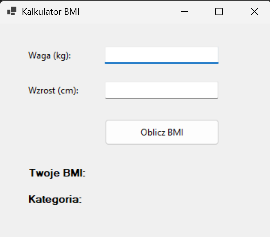

# Zadanie PAD-M1-001: Kalkulator BMI

> Zakres: podstawowe kontrolki + zdarzenie Click + logika obliczeniowa + walidacja

## Polecenie
Zbuduj jednookienkową aplikację liczącą wskaźnik masy ciała (BMI). Użytkownik podaje wagę (kg) i wzrost (cm), a po kliknięciu przycisku aplikacja wyświetla wartość BMI oraz kategorię (niedowaga / waga prawidłowa / nadwaga / otyłość).

| BMI | Kategoria |
|-----|-----------|
| < 18.5 | niedowaga |
| < 25 | waga prawidłowa |
| < 30 | nadwaga |
| >= 30 | otyłość |

### Kontrolki do rozmieszczenia
`lblWaga`, `txtWaga`, `lblWzrost`, `txtWzrost`, `btnOblicz`, `lblWynik`, `lblKategoria`.

### Wygląd aplikacji

### Wymagania funkcjonalne
  - Obliczenie: BMI = waga / (wzrost_w_metrach) ^ 2.
  - Walidacja: błędne/niedodatnie dane → czytelny komunikat w lblWynik (kolor czerwony), bez uruchamiania obliczeń.
  - Wynik BMI zaokrąglony do 1 miejsca po przecinku.
